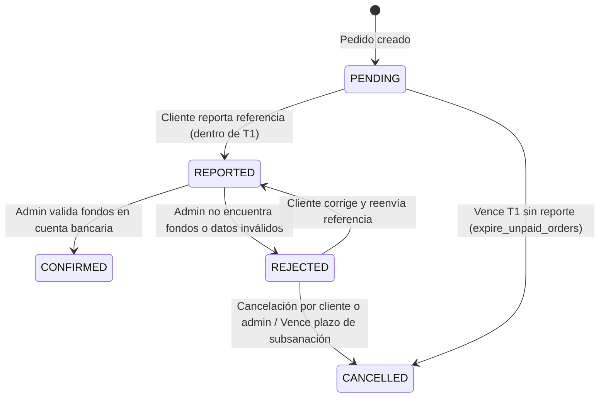

# Política de resolución y vencimiento de pagos (HU-15 / CO-130)

Fecha: 20 de octubre de 2026.  
Ámbito: Proyecto Cypher-Oz (TTI) — Sprint 6.  
Historias relacionadas: HU-15 (CO-44), HU-16 (CO-40), HU-17 (CO-43), HU-18 (CO-61).

---

## 1. Contexto y objetivos

El flujo de pago por transferencia bancaria requiere validación manual por parte del administrador de la tienda antes de proceder con el alistamiento y despacho de los productos. Esta política formaliza:

1. El ciclo de vida de los estados de pago (`PENDING`, `REPORTED`, `CONFIRMED`, `REJECTED`).
2. Las reglas de vencimiento temporal T1 (plazo para reportar pago) y T2 (plazo para revisar pago reportado).
3. Las condiciones de transición hacia la preparación del pedido (`PREPARING`).
4. El tratamiento de pagos rechazados y plazos de subsanación.
5. El principio de protección de inventario y no duplicación de fondos o reembolsos automáticos.

---

## 2. Plazos y temporizadores (T1 y T2)

| Temporizador | Parámetro en configuración | Valor por defecto | Evento de inicio | Condición de vencimiento | Acción al vencer |
|---|---|---|---|---|---|
| **T1** (Plazo de reporte) | `unpaid_order_timeout_hours` | 24 horas | Creación del pedido (`Order.created_at`) | `now >= payment.report_deadline_at` sin reporte (`payment.status == 'PENDING'`) | **Cancelación automática**: El runner `expire_unpaid_orders` cancela el pedido (`status = CANCELLED`), restituye el stock en inventario (`CANCELLATION`), y registra auditoría. |
| **T2** (Plazo de revisión administrativa) | `reported_payment_timeout_hours` | 48 horas | Reporte del pago por el cliente (`payment.reported_at`) | `now >= payment.review_deadline_at` con `payment.status == 'REPORTED'` | **Alerta administrativa / Vencimiento T2**: Notificación prioritaria en bandeja administrativa para resolución urgente. No cancela stock automáticamente de inmediato para no perjudicar al comprador de buena fe que ya transfirió el dinero, pero marca el plazo de SLA vencido para auditoría. |

---

## 3. Matriz de transiciones de pago

### Reglas de negocio:

1. **Confirmación de Pago (`POST /admin/payments/{id}/confirm/`)**:
   - Requiere rol `ADMIN`.
   - Solo aplicable a pagos en estado `REPORTED`.
   - Valida la recepción efectiva del dinero en la cuenta bancaria de la tienda.
   - Pasa el pago a `CONFIRMED` y registra en `PaymentStatusHistory` con el actor administrador.
   - Permite al pedido avanzar a `PREPARING` mediante HU-17.

2. **Rechazo de Pago (`POST /admin/payments/{id}/reject/`)**:
   - Requiere rol `ADMIN`.
   - Solo aplicable a pagos en estado `REPORTED`.
   - Exige especificar un motivo obligatorio (`reason`).
   - Pasa el pago a `REJECTED` y registra en `PaymentStatusHistory`.
   - El cliente es notificado del motivo y tiene la opción de volver a reportar la referencia correcta o cancelar el pedido.

3. **Restricción de preparación del pedido**:
   - Un pedido **NO** puede pasar a `PREPARING`, `SHIPPED` o `DELIVERED` si su pago no está en estado `CONFIRMED`.
   - Cualquier intento de avance administrativo sin pago confirmado genera error `409 Conflict` (`PAYMENT_NOT_CONFIRMED`).

4. **Cancelación y Reembolsos**:
   - Los pedidos con pago `CONFIRMED` no admiten cancelación directa automática por el cliente ("no asumir reembolso/cancelación automática de pago confirmado").
   - La cancelación de un pedido con pago confirmado requiere gestión administrativa con nota de crédito o acuerdo directo fuera de la plataforma automatizada.
